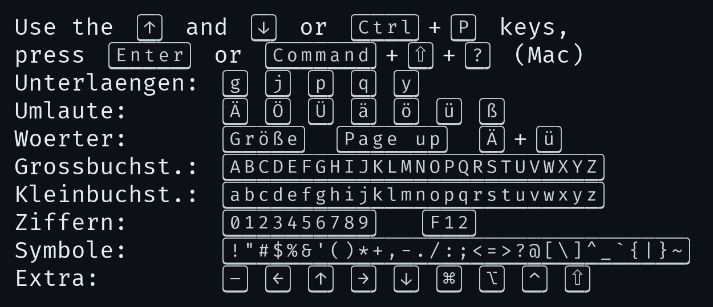

# KbdFrame

Gerahmte Tasten im Terminal für `<kbd>`-Tags in Markdown, angelehnt an die Darstellung auf GitHub.
Die Schrift basiert auf **FiraCode Nerd Font** und wird in kitty über `symbol_map` eingebunden.
Der render-markdown-Handler ersetzt jedes `<kbd>…</kbd>` durch die passenden Zeichen aus der Schrift.



## Belegung

Alle Zeichen liegen in der Supplementary Private Use Area-B ab `U+100000`.
Dieser Bereich wird von Nerd Fonts nicht verwendet, es gibt also keine Überschneidung mit Icons.

| Bereich | Inhalt |
|---|---|
| `U+100001` | linke Kante |
| `U+100002` | rechte Kante |
| `U+100020`–`U+10007E` | druckbares ASCII, Codepunkt = `0x100000` + ASCII-Wert |
| `U+100100`–`U+10010F` | Zusatzzeichen (Pfeile, Mac-Symbole, Umlaute) |

kitty-Konfiguration:

```
symbol_map U+100000-U+1001FF KbdFrame
```

## Übersicht

Großbuchstaben: <kbd>A</kbd> <kbd>B</kbd> <kbd>C</kbd> <kbd>D</kbd> <kbd>E</kbd> <kbd>F</kbd> <kbd>G</kbd> <kbd>H</kbd> <kbd>I</kbd> <kbd>J</kbd> <kbd>K</kbd> <kbd>L</kbd> <kbd>M</kbd> <kbd>N</kbd> <kbd>O</kbd> <kbd>P</kbd> <kbd>Q</kbd> <kbd>R</kbd> <kbd>S</kbd> <kbd>T</kbd> <kbd>U</kbd> <kbd>V</kbd> <kbd>W</kbd> <kbd>X</kbd> <kbd>Y</kbd> <kbd>Z</kbd>

Kleinbuchstaben: <kbd>a</kbd> <kbd>b</kbd> <kbd>c</kbd> <kbd>d</kbd> <kbd>e</kbd> <kbd>f</kbd> <kbd>g</kbd> <kbd>h</kbd> <kbd>i</kbd> <kbd>j</kbd> <kbd>k</kbd> <kbd>l</kbd> <kbd>m</kbd> <kbd>n</kbd> <kbd>o</kbd> <kbd>p</kbd> <kbd>q</kbd> <kbd>r</kbd> <kbd>s</kbd> <kbd>t</kbd> <kbd>u</kbd> <kbd>v</kbd> <kbd>w</kbd> <kbd>x</kbd> <kbd>y</kbd> <kbd>z</kbd>

Ziffern: <kbd>0</kbd> <kbd>1</kbd> <kbd>2</kbd> <kbd>3</kbd> <kbd>4</kbd> <kbd>5</kbd> <kbd>6</kbd> <kbd>7</kbd> <kbd>8</kbd> <kbd>9</kbd>

Symbole: <kbd>!</kbd> <kbd>"</kbd> <kbd>#</kbd> <kbd>$</kbd> <kbd>%</kbd> <kbd>&amp;</kbd> <kbd>'</kbd> <kbd>(</kbd> <kbd>)</kbd> <kbd>&#42;</kbd> <kbd>+</kbd> <kbd>,</kbd> <kbd>-</kbd> <kbd>.</kbd> <kbd>/</kbd> <kbd>:</kbd> <kbd>;</kbd> <kbd>&lt;</kbd> <kbd>=</kbd> <kbd>&gt;</kbd> <kbd>?</kbd> <kbd>@</kbd> <kbd>[</kbd> <kbd>&#92;</kbd> <kbd>]</kbd> <kbd>^</kbd> <kbd>&#95;</kbd> <kbd>&#96;</kbd> <kbd>{</kbd> <kbd>&#124;</kbd> <kbd>}</kbd> <kbd>~</kbd>

Pfeile und Mac: <kbd>–</kbd> <kbd>←</kbd> <kbd>↑</kbd> <kbd>→</kbd> <kbd>↓</kbd> <kbd>⌘</kbd> <kbd>⌥</kbd> <kbd>⌃</kbd> <kbd>⇧</kbd>

Umlaute: <kbd>Ä</kbd> <kbd>Ö</kbd> <kbd>Ü</kbd> <kbd>ä</kbd> <kbd>ö</kbd> <kbd>ü</kbd> <kbd>ß</kbd>

Leerzeichen innerhalb einer Taste: <kbd>Page up</kbd> <kbd>Caps lock</kbd>

## Beispiele

| Fall | Darstellung |
|---|---|
| Kombination | <kbd>Ctrl</kbd>+<kbd>Shift</kbd>+<kbd>P</kbd> |
| Mac | <kbd>Command</kbd>+<kbd>Option</kbd>+<kbd>Esc</kbd> |
| Mac-Symbole | <kbd>⌘</kbd>+<kbd>⇧</kbd>+<kbd>4</kbd> |
| Tastenfolge | <kbd>G</kbd> <kbd>I</kbd> |
| Pfeiltasten | <kbd>↑</kbd> <kbd>↓</kbd> <kbd>←</kbd> <kbd>→</kbd> |
| Funktionstaste | <kbd>F12</kbd> |
| Mehrere Zeichen auf einer Taste | <kbd>abc</kbd> <kbd>Hallo Welt!</kbd> <kbd>v1.2</kbd> |
| Umlaute im Wort | <kbd>Größe</kbd> <kbd>Ä</kbd>+<kbd>ü</kbd> |
| Unterlängen | <kbd>g</kbd> <kbd>j</kbd> <kbd>p</kbd> <kbd>q</kbd> <kbd>y</kbd> |

## Symbole im Detail

Einige Zeichen haben in Markdown oder HTML eine eigene Bedeutung und müssen innerhalb von `<kbd>` maskiert werden.
Die Spalte **Schreibweise** zeigt, was im Markdown stehen muss. Der Handler löst diese Maskierungen genauso auf wie GitHub.

| Taste | Name | Schreibweise | Unicode | KbdFrame |
|---|---|---|---|---|
| <kbd> </kbd> | Leerzeichen | Leerzeichen | `U+0020` | `U+100020` |
| <kbd>!</kbd> | Ausrufezeichen | direkt | `U+0021` | `U+100021` |
| <kbd>"</kbd> | Anführungszeichen | direkt | `U+0022` | `U+100022` |
| <kbd>#</kbd> | Raute | direkt | `U+0023` | `U+100023` |
| <kbd>$</kbd> | Dollar | direkt | `U+0024` | `U+100024` |
| <kbd>%</kbd> | Prozent | direkt | `U+0025` | `U+100025` |
| <kbd>&amp;</kbd> | Und-Zeichen | `&amp;` | `U+0026` | `U+100026` |
| <kbd>'</kbd> | Apostroph | direkt | `U+0027` | `U+100027` |
| <kbd>(</kbd> | Klammer auf | direkt | `U+0028` | `U+100028` |
| <kbd>)</kbd> | Klammer zu | direkt | `U+0029` | `U+100029` |
| <kbd>&#42;</kbd> | Sternchen | `&#42;` | `U+002A` | `U+10002A` |
| <kbd>+</kbd> | Plus | direkt | `U+002B` | `U+10002B` |
| <kbd>,</kbd> | Komma | direkt | `U+002C` | `U+10002C` |
| <kbd>-</kbd> | Bindestrich | direkt | `U+002D` | `U+10002D` |
| <kbd>.</kbd> | Punkt | direkt | `U+002E` | `U+10002E` |
| <kbd>/</kbd> | Schrägstrich | direkt | `U+002F` | `U+10002F` |
| <kbd>:</kbd> | Doppelpunkt | direkt | `U+003A` | `U+10003A` |
| <kbd>;</kbd> | Semikolon | direkt | `U+003B` | `U+10003B` |
| <kbd>&lt;</kbd> | Kleiner als | `&lt;` | `U+003C` | `U+10003C` |
| <kbd>=</kbd> | Gleich | direkt | `U+003D` | `U+10003D` |
| <kbd>&gt;</kbd> | Größer als | `&gt;` | `U+003E` | `U+10003E` |
| <kbd>?</kbd> | Fragezeichen | direkt | `U+003F` | `U+10003F` |
| <kbd>@</kbd> | At-Zeichen | direkt | `U+0040` | `U+100040` |
| <kbd>[</kbd> | Eckige Klammer auf | direkt | `U+005B` | `U+10005B` |
| <kbd>&#92;</kbd> | Backslash | `&#92;` | `U+005C` | `U+10005C` |
| <kbd>]</kbd> | Eckige Klammer zu | direkt | `U+005D` | `U+10005D` |
| <kbd>^</kbd> | Zirkumflex | direkt | `U+005E` | `U+10005E` |
| <kbd>&#95;</kbd> | Unterstrich | `&#95;` | `U+005F` | `U+10005F` |
| <kbd>&#96;</kbd> | Backtick | `&#96;` | `U+0060` | `U+100060` |
| <kbd>{</kbd> | Geschweifte Klammer auf | direkt | `U+007B` | `U+10007B` |
| <kbd>&#124;</kbd> | Senkrechter Strich | `&#124;` | `U+007C` | `U+10007C` |
| <kbd>}</kbd> | Geschweifte Klammer zu | direkt | `U+007D` | `U+10007D` |
| <kbd>~</kbd> | Tilde | direkt | `U+007E` | `U+10007E` |

Buchstaben und Ziffern folgen derselben Regel: <kbd>A</kbd> ist `U+0041` → `U+100041`, <kbd>z</kbd> ist `U+007A` → `U+10007A`, <kbd>0</kbd> ist `U+0030` → `U+100030`.

## Zusatzzeichen

| Taste | Name | Unicode | KbdFrame |
|---|---|---|---|
| <kbd>–</kbd> | Minuszeichen (Halbgeviertstrich) | `U+2013` | `U+100100` |
| <kbd>←</kbd> | Pfeil links | `U+2190` | `U+100101` |
| <kbd>↑</kbd> | Pfeil hoch | `U+2191` | `U+100102` |
| <kbd>→</kbd> | Pfeil rechts | `U+2192` | `U+100103` |
| <kbd>↓</kbd> | Pfeil runter | `U+2193` | `U+100104` |
| <kbd>⌘</kbd> | Command | `U+2318` | `U+100105` |
| <kbd>⌥</kbd> | Option | `U+2325` | `U+100106` |
| <kbd>⌃</kbd> | Control (Mac) | `U+2303` | `U+100107` |
| <kbd>⇧</kbd> | Shift | `U+21E7` | `U+100108` |
| <kbd>Ä</kbd> | A-Umlaut | `U+00C4` | `U+100109` |
| <kbd>Ö</kbd> | O-Umlaut | `U+00D6` | `U+10010A` |
| <kbd>Ü</kbd> | U-Umlaut | `U+00DC` | `U+10010B` |
| <kbd>ä</kbd> | a-Umlaut | `U+00E4` | `U+10010C` |
| <kbd>ö</kbd> | o-Umlaut | `U+00F6` | `U+10010D` |
| <kbd>ü</kbd> | u-Umlaut | `U+00FC` | `U+10010E` |
| <kbd>ß</kbd> | Eszett | `U+00DF` | `U+10010F` |

Zerlegte Umlaute (Grundbuchstabe plus kombinierender Doppelpunkt `U+0308`) werden ebenfalls erkannt.

## Was nicht gerahmt wird

Der Handler fällt auf eine Darstellung mit Hintergrundfarbe zurück, wenn

- ein `<kbd>` ein Zeichen enthält, das nicht in den Tabellen oben steht, zum Beispiel <kbd>€</kbd> oder ein Emoji,
- ein `<kbd>` über mehrere Zeilen geht.

Auf der Zeile mit dem Cursor und im Insert-Mode zeigt render-markdown immer den Rohtext.

## Lizenz

KbdFrame ist von Fira Code abgeleitet und steht deshalb, wie Fira Code selbst, unter der SIL Open Font License 1.1.
Beim Weitergeben der Schrift muss die Lizenzdatei von Fira Code beiliegen.
